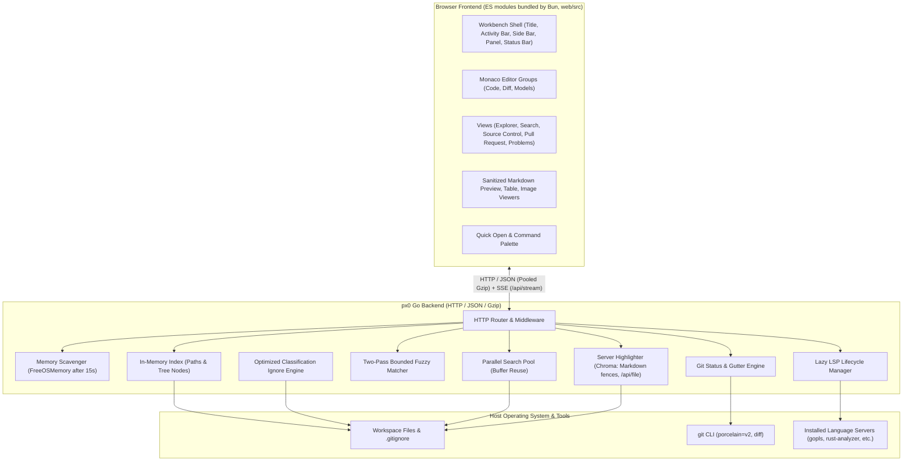

# px0 Internal Architecture & Design Documentation

Welcome to the internal engineering documentation for px0, an ultra-lightweight, zero-config code navigator, editor and PR review tool, packaged as a single statically-linked binary.

This directory contains in-depth technical write-ups explaining how px0 achieves sub-millisecond startup, instantaneous file navigation, deep code intelligence, and a minimal memory footprint (~20–30 MB RSS) across codebases containing tens of thousands of files.

## 1. Subsystem Architecture Map

## 2. Documentation Directory

The internal documentation is modularized into the following focused guides:

### Core Architecture & Server Runtime

- [System Architecture & Runtime Lifecycle](architecture.md): High-level architectural tenets, single-binary distribution, sub-millisecond startup sequence, HTTP router and endpoints, proactive memory scavenging (`debug.FreeOSMemory()`), and path sandboxing.
- [Filesystem Indexing & Ignore Engine](indexing-and-ignore.md): Bounded-concurrency directory traversal (`NumCPU * 4`), instant root availability, symlink cycle immunity, and the custom classification-based `.gitignore` engine.
- [Performance & Comparative Benchmarks](../../BENCHMARKS.md): Measurement methodology across the 7-repository test corpus (Flask to the Linux Kernel) and side-by-side memory/CPU comparison against the VS Code process tree.

### Search & Intelligence Engines

- [Fuzzy Path Matching](fuzzy-search.md): Two-pass bounded search algorithm ($O(N)$ scan time matching dynamic programming ranking accuracy), weighted scoring matrix, and parallel query slicing.
- [Workspace Search & Symbol Extraction](workspace-search.md): Multi-core parallel grep, buffer reuse (`workBuf`), whole-file rejection fast paths (`bytes.Contains`), smart snippet elision (`{Pre, Mid, Post}`), and regex outline extraction.
- [Server-Side Syntax Highlighting](syntax-highlighting.md): Chroma on the server for Markdown code fences and the windowed `/api/file` endpoint (`hlChunk = 1000`, `512 KB` byte cap, dual-tier refinement, byte-budgeted LRU). The editor itself highlights in the browser with Monaco's Monarch tokenizers.
- [Language Server Protocol (LSP) Architecture](lsp-and-intelligence.md): Lazy on-demand server lifecycle, zero-cost background binary discovery, external path boundary control, the Monaco providers in `web/src/lsp.js`, and the regex fallbacks.
- [Git Integration](git-integration.md): CLI shell-out architecture; status and diffs stay read-only, while stage, unstage, discard, commit (and amend), fast-forward-only pull, push and abort are explicit, click-triggered writes. Concurrent status generation, the watcher and event stream, the Source Control status report (`/api/git/status`), file content at a ref (`/api/git/show`) for Monaco's diff editor and the gutter quick diff, and safe repository / unborn HEAD resilience.
- [Pull Request Review & Forge Providers](github-pr-review.md): Extensible `GitProvider` interface in `forge.go` with GitHub, GitLab, Gitea/Forgejo and Bitbucket Cloud providers, URL routing, zero-dependency REST clients, host-scoped multi-source token resolution and the Connect dialog's token check, forge-neutral git transport, merge status and merging, force-with-lease push after a manual rebase, animated CLI spinner, temp-dir worktree checkout scoped to process lifetime, merge-base diffing instead of `HEAD`, fail-closed push-access gating, persisted draft comments, pushing/fast-forward-pulling directly against the PR's own head branch, and the Pull Request view (`web/src/pr.js`).
- [Integrated Terminal](terminal.md): Shells in pseudo-terminals (`creack/pty`) streamed over a WebSocket (`coder/websocket`) to xterm.js, the loopback-only policy and `-terminal`, scrollback replay on re-attach, splits and the key routing between the shell and the workbench.
- [Review Workbench](workbench.md): What a bare `px0` serves. One child px0 per workspace behind a single-port reverse proxy, PRs as worktrees of one discovered or px0-made clone per repository, stdin-tied child lifetimes, idle stop, the holding page that restarts stopped workspaces, stable item IDs, the re-read-on-write `workbench.json` store, the single-instance lock, and the filesystem-browsing security model.

### Frontend & UI Subsystems

- [System Architecture §6, Frontend](architecture.md#6-frontend): the Monaco workbench in `web/src/`, its module structure, the Bun build, and how it talks to the server.
- [File Editing & File Operations](file-editing.md): `/api/file/text`, `/api/file/save` with mtime conflict detection, `/api/file/stat`, `/api/fs/*`, the `tree` stream event, and the Monaco document model (`web/src/models.js`).
- [File Updates & Reloading Open Files](file-reload-and-updates.md): how open documents notice changes on disk, reload quietly or flag a conflict, and how the explorer and git state follow the server's event stream.
- [Image Viewer](image-viewer.md): image tabs, zoom, and the binary placeholder (`web/src/previews.js`).
- [Markdown Preview Implementation](markdown.md): Goldmark pipeline, heading IDs, highlighted fences, the browser-side DOM allowlist sanitizer, Mermaid, and the CSV/TSV table preview.
- [Theme Architecture & CSS Tokens](styling-and-themes.md): CSS custom property tokens, `/static/themes.css`, how `web/src/theme.js` maps a theme onto Monaco, and custom theme authoring.

### Operations & Maintenance

- [Testing, Micro-Benchmarks & Subsystem Coverage](testing-and-benchmarks.md): Testing philosophy, 100% package coverage guarantee, statement coverage metrics, over 80 Go micro-benchmarks, the unified verification runner (`./scripts/test-bench.sh`), and the frontend check (`scripts/check-web.js`, `bun test web/src/`).
- [User Features Documentation](../features/README.md): High-level feature guides, practical workflows, and keyboard shortcuts for all px0 capabilities.
- [AI Agent Operational Guidelines](../agents/README.md): Engineering principles for AI coding agents, mandatory documentation maintenance protocol, and frontend codebase index.
- [Publishing & Release Guide](../../PUBLISHING.md): Step-by-step instructions for preparing, testing, and publishing new px0 releases.
