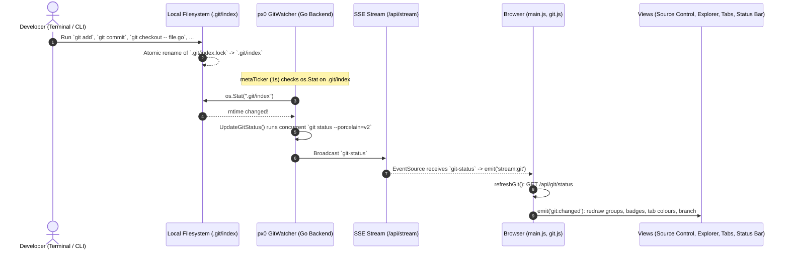

# Git Integration: Status, Diffs & Stage/Commit/Push/Pull

This document describes the design and implementation of px0's git engine ([`git.go`](../../git.go), [`server.go`](../../server.go)) and the browser side that uses it: git state ([`web/src/git.js`](../../web/src/git.js)), the Source Control view ([`web/src/scm.js`](../../web/src/scm.js)), the gutter quick diff ([`web/src/dirtydiff.js`](../../web/src/dirtydiff.js), [`web/src/linediff.js`](../../web/src/linediff.js)) and Monaco's diff editor ([`web/src/editors.js`](../../web/src/editors.js), [`web/src/models.js`](../../web/src/models.js)).

## 1. Zero-Dependency Shell-Out Architecture

px0 avoids heavy third-party Go git libraries (such as `go-git`, which can consume large amounts of memory re-parsing packfiles, or `libgit2`, which requires CGO).

Instead, px0 adheres to a Pure Shell-Out Architecture:

- Shells out directly to the host `git` binary, for reads (`status`, `diff`, `merge-base`, `cat-file --batch`) and, for the Source Control view, writes (`add -A`, `reset`, `rm --cached`, `restore --worktree`, `commit`, `commit --amend`, `push`, `fetch`, `merge --ff-only`, `reset --hard`, and `--abort` for a rebase, merge, cherry-pick or revert).
- Status and diffing themselves never stage, commit, or change refs or the index — that half of the engine is still purely read-only. The write endpoints (`/api/git/stage`, `unstage`, `discard`, `hunk`, `commit`, `push`, `pull`, `abort`) are the only exception, and every one of them fires exactly once per explicit click; nothing runs on a timer or in response to a file change. See §9.
- Zero disk footprint: holds all status and diff structures in volatile memory on the `Index` (`Node.Status`, `Node.Staged`).
- Graceful degradation: if `git` is not installed, or if the opened directory is not a git repository, git features degrade silently without warnings or errors.
- Can be disabled explicitly using the `-no-git` CLI flag.

## 2. Concurrent Status Generation

On large repositories, running `git status` can take 50-100 milliseconds. Running this serially during startup would delay index readiness.

px0 runs `git status` concurrently alongside the filesystem walk:

```go
gsCh := make(chan map[string]string, 1)
go func() { gsCh <- gitStatus(ix.root) }()

// Walk directory tree concurrently...
walk(ix.root, "", root)

// Overlay git status onto index nodes
gs := <-gsCh
```

### Git Command Specification

px0 invokes:

```bash
git status --porcelain=v2 -z
```

- `--porcelain=v2`: Machine-readable format immune to user git config customizations.
- `-z`: NUL-delimited output preventing issues with filenames containing spaces, tabs, quotes, or Unicode characters.

## 3. In-Memory Status & Dirty Folder Propagation

Git status codes are mapped onto tree nodes:

- `M`: Modified
- `A`: Added / Staged
- `D`: Deleted
- `U`: Untracked
- `R`: Renamed

Separately, `Node.Staged` (a plain bool, not folded into the status letter) tracks whether a file has staged index changes — see §9 for how it is populated.

### Ancestor Folder Dirty Propagation (`Node.Dirty`)

When a file is modified, its status is recorded on its `Node.Status`. Furthermore, every ancestor folder in its path hierarchy is marked `Dirty: true`:

```go
for p := rel; p != ""; {
    if i := strings.LastIndexByte(p, '/'); i >= 0 {
        p = p[:i]
    } else {
        p = ""
    }
    for i := range children[p] {
        if children[p][i].Dir && isAncestor(children[p][i].Path, rel) {
            children[p][i].Dirty = true
        }
    }
}
```

`/api/tree` nodes carry this flag. The current explorer computes the same set in the browser from `/api/git/status` (`G.dirtyDirs` in `web/src/git.js`) and marks those folders with a dot, so changes are visible with the folder collapsed.

## 4. Diffs

### In the editor

The Monaco frontend never parses a unified diff. Both of its diff surfaces compare two full texts in the browser:

- **Diff editor.** A diff tab (`openDiff` in `editors.js`) has a `left` and a `right` side, each `{ref}` (a git version), `{path}` (the live workspace document, editable) or `{empty: true}`. `originalModel(path, ref)` in `models.js` fetches a git version once from `/api/git/show` (§9) and keeps it as a read-only model with a `git:` URI keyed by path and ref; the working-tree side is the file's shared document model. Monaco's diff editor (`diffAlgorithm: 'advanced'`) computes and renders the diff, inline or side by side. The sides the Source Control view uses:

  | Opened from | Left | Right |
  | --- | --- | --- |
  | Changes | `INDEX` | the working-tree document (editable), or empty for a deletion |
  | Staged Changes | `HEAD` (or the rename source at `HEAD`), empty for an addition | `INDEX`, empty for a deletion |
  | A commit's file | `<sha>^` | `<sha>` |
  | A PR file | `BASE` (the merge-base) | the working-tree document |
  | Compare | one workspace file | another workspace file (both editable) |

  Read-only sides are fetched when the tab opens and are not refreshed afterwards.
- **Gutter quick diff** (`dirtydiff.js`). For every plain code editor on a changed, tracked file of up to 20,000 lines, it diffs the file's `INDEX` text (from `/api/git/show`) against the model with `diffLines` (`linediff.js`, Myers' O(ND) algorithm over line arrays), debounced 250 ms after each edit, and draws `dd-added` / `dd-modified` / `dd-deleted` line decorations plus overview-ruler marks. Within a hunk, new lines up to the length of the replaced run count as modified, the rest as added; a hunk with no new lines is a deletion marker. After a px0 git operation the `INDEX` text is re-read. Clicking a bar runs **Open Changes** at that line.

### Server-side diff endpoints

The server can also diff a file against a base with one shell-out, `gitDiff(root, relpath)`:

```bash
git diff --no-color HEAD -- <path>
```

- `/api/gutter?path=` runs it through `gitHunks`, a small state machine over the `@@ -l,s +l,s @@` headers and `+`/`-` lines, and returns 1-based new-file line numbers in `added`, `modified` (a `-` run immediately followed by a `+` run) and `deleted` (one marker per pure deletion, at the line it sat before).
- `/api/diff?path=` returns the raw diff text as `{ path, diff, available }`.

Both take an optional `ref` (§10) and diff against `s.diffBase` (§8). The current frontend uses neither: it computes diffs from `/api/git/show` texts as above.

## 5. Real-Time Streaming & Adaptive Monitoring Engine

To keep git status, explorer badges and the Source Control view in sync without manual reloads or re-indexing, px0 uses a hybrid real-time monitoring engine (`git.go` on the server, the event stream in `web/src/main.js` and `web/src/git.js` in the browser).

### Design Constraints: Small vs. Massive Repositories

| Approach | Small Repo (< 1k files) | Massive Repo (> 100k files, e.g. Linux / Chromium) | Verdict |
| :--- | :--- | :--- | :--- |
| **Recursive FS Watcher (`inotify`)** | Fast, low RAM | Exhausts OS watch descriptors (`max_user_watches`), high memory footprint, breaks across symlinks / mount points | **Rejected** |
| **Fixed High-Frequency Polling** | Instant updates (~6ms) | Heavy CPU and battery drain (100k+ file `git status` takes 150ms-1s) | **Rejected** |
| **px0 Hybrid Adaptive Engine** | Sub-millisecond latency, zero RAM overhead | Sub-millisecond on CLI git actions; worktree polling throttled dynamically; CPU usage bounded $\le 10\%$ | **Adopted** |

### Dual-Layer Hybrid Architecture

1. **Sub-millisecond Metadata Stat-Checking (Fast Path)**
   - Every 1 second, px0 checks the `os.Stat` timestamps and sizes of key `.git` control files: `.git/index`, `.git/HEAD`, and `.git/packed-refs`.
   - Any git operation performed in the terminal (`git commit`, `git checkout`, `git add`, `git reset`, `git merge`) immediately touches these files.
   - When a metadata change is detected, px0 triggers an immediate `UpdateGitStatus()` and broadcasts the delta to the frontend within milliseconds without waiting for the next worktree poll.

2. **Adaptive Worktree Polling (Worktree Path)**
   - To catch file changes made outside the git CLI (e.g. saving an editor file or external scripts), the engine polls `UpdateGitStatus()`.
   - **Self-Tuning Frequency**: Measures the exact execution time of the previous `git status` call and adjusts the polling interval:
     $$\text{interval} = \max(2\,\text{s}, \min(15\,\text{s}, \text{execution\_time} \times 10))$$
     On small repositories (~6ms execution), it polls every 2 seconds. On massive repositories (~1s execution), it expands the interval to 10-15 seconds, ensuring git polling never consumes more than a modest fraction of one CPU core.

3. **Visibility & Focus Gating**
   - **Page Visibility API**: When the browser tab is hidden (`document.visibilityState === 'hidden'`), the frontend closes the SSE connection. The backend detects zero active subscribers and pauses background worktree polling completely, saving CPU and laptop battery.
   - **Instant Wakeup**: When the page becomes visible again, the client reconnects the stream and immediately refetches `/api/git/status` to catch changes made while it was hidden. (`POST /api/git/refresh`, which forces a status run and returns the payload, is still served but the current frontend does not call it.)

4. **In-Memory Concurrency & Tree Updates (`UpdateGitStatus`)**
   - Refreshing git status does not re-walk the directory tree on disk.
   - `Index.UpdateGitStatus()` executes `gitStatus(ix.root)` concurrently, compares the new status map against `ix.gitStatusMap`, and if changed, updates `Node.Status` and `Node.Dirty` in-place on existing `ix.children` nodes.
   - If the status map is identical, no memory allocations or broadcasts occur.

5. **Server-Sent Events (SSE) Stream (`/api/stream` / `/api/git/stream`)**
   - Implemented using Go standard library `http.Flusher` without external dependencies.
   - Dispatches structured events (`git-status`, `tree`, and `metrics`):
     ```
     event: git-status
     data: {"git":true,"gitChanges":2,"gitFiles":["main.go","git.go"],"statuses":{"main.go":"M","git.go":"M"},"dirtyDirs":{"web":true}}
     ```
   - Sends `: ping\n\n` comments every 15 seconds to keep connections alive across reverse proxies.
   - Also dispatches `event: tree` (`data: {}`) when the file tree changed shape (`GitWatcher.NotifyTree`). Besides px0's own file operations and discards ([File Editing](file-editing.md)), the watcher emits it when a status refresh shows untracked files appearing or disappearing that the index has wrong; it first updates the index for them with `TouchPath` (for a deleted folder, the highest folder gone). Changes to ignored files, non-git workspaces, and tracked files appearing from a branch switch are not detected this way.

6. **Browser Side (`web/src/git.js`)**
   - The client does not apply the stream's payload directly. A `git-status` event becomes `stream:git` on the bus, and `refreshGit()` (debounced 120 ms; also after a save or a file operation) fetches `/api/git/status` and rebuilds `G`: branch, upstream, ahead/behind, operation, the three lists, `byPath` (the decoration for each file, the working-tree status winning) and `dirtyDirs` (every ancestor folder of a change).
   - `git:changed` then redraws the Source Control view and its badge, the explorer rows (only rows whose signature changed get a new element), tab colours, the status bar's branch and sync items, and the gutter quick diff.

## 6. How Git Detects Changes Under the Hood

To understand why px0's metadata stat-checking fast path works in sub-milliseconds, it is essential to understand how Git itself detects changes in the working tree.

### The Stat Cache (`.git/index`)

Git does **not** read or compute cryptographic hashes (SHA-1 / SHA-256) of every file in the repository on every status check. On a 50,000-file repository, reading and hashing gigabytes of source code would take tens of seconds and stall developer workflows.

Instead, Git maintains a binary cache in `.git/index` containing metadata for every tracked file:

* **`mtime`**: Last modified timestamp (stored as seconds and nanoseconds).
* **`ctime`**: Status change timestamp.
* **`size`**: Exact file size in bytes (truncated to 32 bits).
* **`inode` & `dev`**: File system device and inode numbers.
* **`mode`**: File permissions (e.g. `100644` standard, `100755` executable, `120000` symlink).
* **`blob SHA`**: The hash of the file contents when it was last staged or committed.

```
Working Tree File                      .git/index (Binary Cache)
┌─────────────────────────┐            ┌────────────────────────────────────────┐
│ src/main.go             │            │ src/main.go                            │
│ - size: 4,120 bytes     │  lstat()   │ - cached size: 4,120 bytes             │
│ - mtime: 09:15:02.1492  │ ◄────────► │ - cached mtime: 09:15:02.1492          │
│ - inode: 849201         │  metadata  │ - cached inode: 849201                 │
│                         │ comparison │ - blob SHA: 3a7f92b1c8e0...            │
└─────────────────────────┘            └────────────────────────────────────────┘
```

### The `lstat()` Fast-Path

When `git status` or `git diff` runs:

1. **Lightweight System Call**: Git calls `lstat()` on each working tree file. `lstat()` only reads filesystem directory entries and inode records; it does not read file contents.
2. **Metadata Comparison**: Git compares the file's live `mtime`, `size`, `inode`, and `mode` against the record stored in `.git/index`.
3. **Instant Skip (Unchanged)**: If the metadata matches identically, Git **guarantees the file is untouched**. It skips reading or hashing the file completely.
4. **Targeted Read (Modified)**: Only when the timestamp, size, or mode differs does Git open the file, calculate its blob SHA, and compare it against the cached `blob SHA`.
5. **Merkle Tree Pruning (`Index` vs `HEAD`)**: For comparing staged files against the `HEAD` commit, Git compares the 20-byte/32-byte tree hashes. If a directory tree hash matches `HEAD`, the entire subdirectory subtree is skipped in memory without examining individual files.

Because `lstat()` is memory-cached by the OS VFS page cache, a full `git status` scan across 50,000 files completes in 10–25 milliseconds.

### Why Every Git CLI Command Touches `.git/index`

Whenever a developer runs a Git command in the terminal (`git checkout`, `git reset`, `git add`, `git commit`, `git restore`, `git stash`, or `git merge`):

* Git updates the working tree and writes a new index via an atomic `.git/index.lock` swap (`rename()`).
* This atomic rename guarantees that the `mtime` and `ctime` of `.git/index` change.
* Git also updates `.git/HEAD` or ref pointers (`.git/refs/heads/<branch>` or `.git/packed-refs`).

By monitoring the `os.Stat` timestamp of just `.git/index`, `.git/HEAD`, and `.git/packed-refs`, px0's fast path detects any terminal Git action in sub-millisecond time without scanning the workspace.

---

## 7. End-to-End Reactive Flow

The following sequence follows a git command in a terminal to the browser:



Open diff tabs are left alone: a file whose changes were discarded in a terminal keeps its diff tab until the user closes it.

## 8. Diffing Against an Arbitrary Base

`gitDiff`/`gitHunks` above are thin `base="HEAD"` wrappers around `gitDiffAgainst`/`gitHunksAgainst`, which take an arbitrary base ref rather than assuming the working tree's `HEAD`. The one other caller is PR review (`px0 <url>`), which diffs a checked-out PR against its merge-base with the target branch instead. See [Pull Request Review](github-pr-review.md).

## 9. Stage, Commit, Push, Pull

The Source Control view (`web/src/scm.js`) and the Git commands in the palette are the write half of git integration. Every action is a single explicit HTTP call from a click or a command; nothing here is triggered by the status watcher, a timer, or a file change. `op()` in `web/src/git.js` runs one operation at a time, shows it in the status bar (`G.busy`), reports a failure as a notification with git's message, and refetches status afterwards (`git:after-op`).

### Staged-Path Tracking

`gitStatusAndStagedAgainst` (`git.go`) extracts both working-tree status codes and staged paths (`xy[0] != '.'`) from a single `git status --porcelain=v2 -z -uall` invocation (with `gitStagedPaths` available as a standalone `git diff --name-only --cached -z` helper when only staged paths are needed), mapping each path through `repoRelKey` so staged state is keyed identically to status. `Index.gitStagedMap` and `Node.Staged` carry it alongside the existing `gitStatusMap`/`Node.Status`, populated in both `Index.Build()` and `Index.UpdateGitStatus()`. `UpdateGitStatus`'s "did anything change" check compares *both* maps — staging a file often leaves its collapsed status letter unchanged (a modified-and-unstaged `M` and a modified-and-staged `M` are the same letter), so comparing status alone would silently swallow a stage/unstage broadcast. `GitStatusPayload` (`git.go`) carries the resulting `Staged` map and the current `Branch` name (`gitCurrentBranch`) down the same SSE stream (`/api/stream`) that already pushes status; during worktree-only polls when `.git` control files have not changed, `GitWatcher` reuses the cached branch, ahead/behind, and recent-commit metadata from `lastSnap`.

### Source Control Status (`/api/git/status`)

`GET /api/git/status` (`handleGitStatus`, `gitStatusReport` in `git.go`) is what an editor's Source Control view lists, with VS Code's semantics:

- `staged`: the index against `HEAD`, one git letter per path (`A M D R C T`); a rename or copy also carries `from`.
- `changes`: the working tree against the index (`M D T`, or `U` for an untracked file).
- `conflicts`: unmerged paths with git's two-letter code (`UU`, `AA`, `DU`, ...).

A file staged and then edited again is in both `staged` and `changes`. Around the lists it reports `git`, `branch` (`""` when detached), `detached`, `head` (7-character) and `headFull`, `upstream`, `ahead`, `behind`, and `operation` (`""`, `merge`, `rebase`, `cherry-pick` or `revert`, from `gitOpInProgress`). It comes from one `git status --porcelain=v2 -z --branch --untracked-files=all` (`parseStatusV2`), run with `GIT_OPTIONAL_LOCKS=0` so it never takes the index lock a terminal git would trip over. At most 5,000 entries are listed across all three groups (`gitStatusMax`); past that `truncated` is `true`. Not a repository, or git disabled, is `git: false` with empty lists. In a PR review session the checkout is a detached HEAD, so `upstream` is the PR's head branch and `ahead` counts the commits made on top of the PR head (`behind` is 0).

### Stage / Unstage / Commit & Auto-Staging

`/api/git/stage` and `/api/git/unstage` take `{path}`, `{paths: [...]}`, or `{all: true}` (`decodeGitPaths`, every path through `s.safePath`). `gitStagePaths` runs `git add -A -- <paths>` (modifications, deletions and untracked files alike) and `gitUnstagePaths` runs `git reset -q HEAD -- <paths>`; `all` is the served root itself. Every git command px0 runs on the user's behalf goes through `gitCmd`, which sets `GIT_LITERAL_PATHSPECS=1` (a file named `*.go` means that file, not every Go file), `GIT_OPTIONAL_LOCKS=0` and `GIT_TERMINAL_PROMPT=0`. `gitPaths` splits a long path list across as many invocations as it takes (about 16 KB of paths each, under Windows' command-line limit). On an unborn `HEAD`, where `git reset` cannot resolve `HEAD`, unstage falls back to `git rm -r -q --cached --ignore-unmatch`. Both return the fresh status payload (`gitChanged`).

`POST /api/git/commit` takes `{message, amend?}`. A plain commit runs `git commit -m <message>`. The frontend itself asks before committing with nothing staged (VS Code's smart commit prompt, remembered with **Always**) and stages everything with `{all: true}` first; the server keeps its own fallback: when nothing is staged, `handleGitCommit` checks `gitHasUncommittedChanges(root)` and, if modified or untracked files exist, stages everything via `gitStage(root, ".")` first. If the working tree is completely clean, it fails fast with "nothing staged to commit". With `amend: true` it runs `git commit --amend -m <message>`, or `git commit --amend --no-edit` when the message is empty, and does **not** auto-stage: the amended commit takes what is staged and only that (with nothing staged it rewrites just the message). Every write endpoint calls `s.gitWatcher.Trigger()` (or `Refresh()`) on success so the SSE stream broadcasts immediately instead of waiting for the next poll tick.

### Discarding Changes (`/api/git/discard`)

`POST /api/git/discard` with `{paths: [...]}` (or `{path}`) throws away working-tree changes only, the way an editor's "Discard Changes" does (`gitDiscardPaths`). Staged work survives:

- Paths the index knows (`git ls-files`, a folder counts when it holds anything tracked) are restored from the index with `git restore --worktree`, falling back to `git checkout --` on git older than 2.23.
- Untracked files under the paths (`git ls-files --others --exclude-standard`) are deleted, and folders left empty by that are removed too. Ignored files are never touched, and neither is a nested repository (listed with a trailing slash).

The workspace root and anything in or under `.git` are refused (`editablePath`). Afterwards every restored or removed path goes through `treeChanged` (cache eviction, LSP close, `Index.TouchTree`) and `fsChanged(true)`, which emits a `tree` event, since restoring brings deleted files back and removing takes untracked ones away. Returns `{ok: true, ...}` with the same status payload stage returns.

### File Content at a Ref (`/api/git/show`)

`GET /api/git/show?path=&ref=` returns one file as it is at a ref, for the original side of a diff editor: `{path, ref, exists, binary, tooLarge, text, size, eol}`, with the same `text`/`binary`/`tooLarge`/`eol` rules as `/api/file/text` ([File Editing](file-editing.md)). `ref` is:

| `ref` | Reads |
| --- | --- |
| `HEAD` (default) | the last commit |
| `INDEX` | the staged blob (`:path`) |
| `BASE` | `s.diffBase`, what `/api/diff` compares the working tree with: the merge-base in a PR review, `HEAD` otherwise |
| a commit SHA | that commit |
| `<sha>^` | its first parent |

Anything else is `400`. `gitBlob` feeds one `<rev>:./<path>` spec to `git cat-file --batch` and reads the header first, so a blob over 20 MB is reported by size without being read. A file missing at the ref (an unborn `HEAD`, the parent of the commit that added it) is `exists: false` with `200`, not an error; a directory is `400`.

### Single-Hunk Actions (`/api/git/hunk`)

The server can also stage, unstage or discard a single diff hunk (the current frontend does not offer it). `gitApplyHunk(root, patch, action)` (`git.go`) pipes a zero-context unified patch (`--unidiff-zero`) directly into Git:
- **`stage`**: Runs `git apply --cached --unidiff-zero -` to stage only the selected hunk.
- **`unstage`**: Runs `git apply --reverse --cached --unidiff-zero -` to unstage that specific hunk from the index while keeping working-tree modifications.
- **`discard`**: Runs `git apply --reverse --unidiff-zero -` to discard that hunk's changes from the working tree.

### Safe Repositories & Unborn HEAD Resilience

`gitProbe` verifies whether the workspace root is a valid, accessible Git repository and handles `safe.directory` checks gracefully. When a repository is freshly initialized without any commits (an unborn `HEAD`), branch detection reads `ref: refs/heads/<name>` directly from `.git/HEAD`, diffing falls back safely without error, and staging/unstaging endpoints avoid failing on non-existent `HEAD` references.

### Fast-Forward-Only Pull

`gitFFOnlyPull(root, remote, ref)` fetches `ref` from `remote` and runs `git merge --ff-only FETCH_HEAD`. If that merge fails for any reason, it returns the sentinel `errNotFastForward` without having touched history — px0 never falls back to a real merge, so there is never a conflicted state to clean up. `handleGitPull` (`server.go`) first refuses (409, `code: "in-progress"`) if a rebase, merge, cherry-pick or revert is already half-done (`gitOpInProgress`, see below), then refuses (409) if the working tree is dirty, then resolves the branch's upstream (`gitUpstream`, wrapping `git rev-parse --abbrev-ref <branch>@{u}`) and calls `gitFFOnlyPull`. On `errNotFastForward` it answers 409 through `failSync`, which carries a `gitSyncState` (`code: "diverged"`, branch, upstream, ahead/behind, in-progress op, dirty) next to the message. The fetch has already landed by then, so the counts describe the remote as it is now.

### Operations Left in Progress

px0 never starts a rebase, merge, cherry-pick or revert itself, but one started in a terminal can be left half-done. `GET /api/git/sync-state` (`handleGitSyncState`) reports `{branch, upstream, ahead, behind, inProgress, dirty}` (plus `pr` and `rewritten` in a PR review session), where `inProgress` is `gitOpInProgress`: `rebase` (`rebase-merge`/`rebase-apply` in the git dir), `merge` (`MERGE_HEAD`), `cherry-pick` (`CHERRY_PICK_HEAD`) or `revert` (`REVERT_HEAD`). `POST /api/git/abort` (`gitAbortOp`) runs `git <op> --abort`, restoring the branch to where it was before that operation started, and answers `409` when nothing is in progress.

### Errors

A failed write answers with an HTTP error and git's message. The frontend shows it as an error notification, with the operation (`git commit`, `git push`, ...) as its detail. A Pull that would not fast-forward returns `409` with `code: "diverged"` and the sync state; the message says how far the branches have diverged.

In a PR review session, Pull instead re-syncs with the pull request's current head — see [Pull Request Review §7](github-pr-review.md).

### Push

For a plain workspace, `handleGitPush` runs a bare `gitPush` (`git push`); if that fails specifically because the branch has no upstream, it retries once with `gitPushSetUpstream(root, "origin", branch)`. Neither path ever forces. In a PR review session, `s.pr.Push(force)` takes over instead (`force` only after a confirmed force-push of a rebased PR, as a lease) — see [Pull Request Review §7](github-pr-review.md).

### HTTP Surface

| Endpoint | Method | Purpose |
| --- | --- | --- |
| `/api/git/status` | GET | Staged / changes / conflicts lists, branch, `head`, upstream, ahead/behind, operation in progress. |
| `/api/git/show` | GET | `?path=&ref=` — a file at `HEAD`, `INDEX`, `BASE`, a commit, or its first parent. `exists: false` when missing there. |
| `/api/git/stage` | POST | `{path}`, `{paths}` or `{all: true}` — stage. Returns fresh status payload. |
| `/api/git/unstage` | POST | `{path}`, `{paths}` or `{all: true}` — unstage. Returns fresh status payload. |
| `/api/git/discard` | POST | `{paths}` — discard working-tree changes; untracked files are deleted. Returns `{ok}` plus the status payload. |
| `/api/git/hunk` | POST | `{path, hunk, action}` — stage, unstage, or discard an isolated diff hunk. |
| `/api/git/commit` | POST | `{message, amend?}` — commit staged changes (auto-stages everything if none staged), or amend the last commit with what is staged. `400` if working tree is clean. |
| `/api/git/push` | POST | Push the current branch, or (PR session) the PR's head branch. |
| `/api/git/pull` | POST | Fast-forward pull, or (PR session) re-sync with the PR head. `409` on divergence (with `code: "diverged"` and the sync state), an operation in progress (`code: "in-progress"`), or uncommitted changes. |
| `/api/git/sync-state` | GET | Branch, upstream, ahead/behind, in-progress op, dirty. |
| `/api/git/abort` | POST | Abort the rebase, merge, cherry-pick or revert in progress. `409` if there is none. |
| `/api/git/log` | GET | `{commits, commitsUrl}` — recent commits from `HEAD`. `?limit=` (default 5, at most 200), `?skip=` to page further back. Each commit has `hash`/`short`, `full`/`sha` (full SHA), `subject`, `author`, `email`, `date` (relative) and `time` (author date, unix seconds). |

Every write endpoint is guarded by `localPost` ([`server.go`](../../server.go)), the same POST-only, same-origin, IP-or-localhost check every other mutating px0 endpoint uses.

## 10. Unpushed Commits (`@{u}..HEAD`)

Everything above diffs against the working tree. Once a change is committed it leaves that view, even though a local commit is exactly the thing most likely to still need reading. This section is the read path for commits, unpushed ones in particular.

It is strictly read-only: no endpoint here writes to the index, a ref, or a remote. Every call fails quiet the way the rest of `git.go` does — no upstream, no git, or an unknown SHA all yield an empty result rather than an error.

### Which Commits, and Against What

`gitUpstreamRef(root)` runs `git rev-parse --abbrev-ref --symbolic-full-name @{u}` and returns the tracking branch as git names it (`origin/master`). `gitUnpushedCommits(root, limit)` then logs `@{u}..HEAD`, newest first.

Unlike `gitAheadBehind`, there is **no `origin/<branch>` fallback and no "count every local commit" fallback**. Those exist so the Push button can still light up on an unpublished branch, where being approximately right is better than being dead. A list of commits is different: measuring it against a branch git does not consider upstream would show a confident, wrong answer. With no upstream configured, `/api/unpushed` reports `available: false` and no commit is marked unpushed.

The upstream ref name travels with the list, because "unpushed" alone doesn't say *unpushed where*: a branch can be ahead of `origin/master` and behind a fork's.

### Per-Commit Reads

Three reads share one set of `git diff-tree` flags (`commitDiffArgs`): `--no-commit-id -r -m --first-parent --root`. That combination gives one entry per **path** rather than per tree, and `--root` means the repository's very first commit still has something to diff against, so it needs no empty-tree special case. `-m --first-parent` makes a merge commit diff against the branch it merged into, which is the only reading of a merge that matches a list of the branch's own commits.

| Function | Shell-out | Returns |
| --- | --- | --- |
| `gitCommitFiles(root, sha)` | `git diff-tree --name-status -z …` + `gitCommitNumstat` (`git show --numstat -z -m --first-parent`) | Paths the commit touched, with git's status letter (`M`/`A`/`D`/`R`/`C`/`T`) and each path's `add`/`del` line counts (`binary` when numstat reports `-`), mapped through `repoRelKey` so a repo served from a subdirectory lists only what it can open. |
| `gitCommitDetail(root, sha)` | `git show -s --format=…` + `git diff-tree --numstat …` | Author, email, relative and ISO dates, the full message, and the files/insertions/deletions diffstat. |
| `gitDiffCommit(root, relpath, sha)` | `git diff-tree -p --no-color …` | The unified diff that commit alone made to one file. |

`gitHunksCommit` feeds `gitDiffCommit`'s output to `parseDiffHunks` — the same state machine `gitHunksAgainst` uses, split out of it so a commit's gutter and the working tree's are parsed by one piece of code.

Every SHA that reaches `exec.Command` as a bare revision passes `validSHA` (`^[0-9a-fA-F]{4,40}$`) first. The only way a SHA reaches these endpoints is from a list px0 itself produced, so anything else is a bug or a probe; refusing it keeps a crafted `--upload-pack=…` out of an argument list.

### The `ref` Parameter on `/api/diff` and `/api/gutter`

Rather than add two more endpoints, the existing diff and gutter endpoints take an optional `ref`:

- **`ref` empty** — unchanged: the working tree against `s.diffBase` (`HEAD`, or a PR merge-base in review mode).
- **`ref=<sha>`** — that commit's own diff, via `gitDiffCommit`/`gitHunksCommit`. The working tree is not consulted at all, so the result is frozen no matter what is edited afterwards.

`/api/file` takes the same parameter, for one reason: a file the commit **deleted** has nothing on disk, so the existing "does the working tree have a diff for it" check can't vouch for it and the open would 404. With a `ref`, `handleFile` asks whether that commit touched the path instead, and returns the same zero-line `deleted: true` document a working-tree deletion produces.

### HTTP Surface

| Endpoint | Method | Purpose |
| --- | --- | --- |
| `/api/unpushed` | GET | `{available, upstream, commits[]}` — commits in `@{u}..HEAD`, newest first. `available: false` with no upstream or nothing ahead. |
| `/api/commitfiles?sha=` | GET | `{sha, files[]}` — the paths one commit touched, with status letters and line counts. Empty list for an unknown SHA. |
| `/api/commitdetail?sha=` | GET | Author, message and diffstat. `404` for an unknown SHA. |
| `/api/diff?path=&ref=` | GET | With `ref`, that commit's diff for the file instead of the working tree's. |
| `/api/gutter?path=&ref=` | GET | Same, for the change gutter. |
| `/api/file?path=&ref=` | GET | `ref` only matters for a file the commit deleted; it opens as a zero-line deleted document so its diff can be read. |

All six are GET reads with no `localPost` guard, because none of them changes anything.

### Frontend (`web/src/scm.js`)

The **Commits** section of the Source Control view lists `/api/git/log` (50 at first, **Load More Commits...** up to 200) and marks the commits in `/api/unpushed` with a cloud icon. Expanding a commit fetches `/api/commitfiles?sha=` once and lists its files with status letters and `+`/`−` counts. Clicking a file opens a diff tab whose sides are `{ref: '<sha>^'}` and `{ref: '<sha>'}` (empty for an added or deleted file, and the rename source on the left), read through `/api/git/show`, so the diff is that commit's alone, whatever the working tree holds. The list reloads after commit, push, pull and abort, and on `stream:git` while the section is expanded.

The current frontend does not use `/api/commitdetail` or the `ref` parameter of `/api/diff`, `/api/gutter` and `/api/file`.
