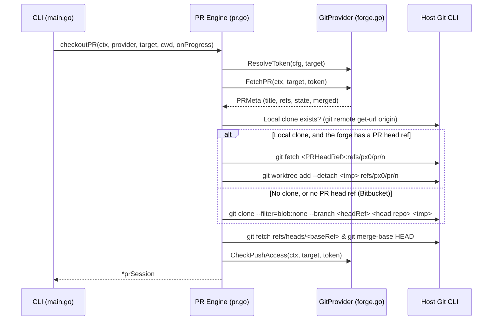

# Git Forge PR Review & Provider Architecture

This document describes the design and implementation of px0's pull request review feature:
- the `GitProvider` abstraction layer and its implementations for GitHub, GitLab, Gitea / Forgejo, and Bitbucket Cloud ([`forge.go`](../../forge.go));
- connecting a forge token from the UI ([`forge.go`](../../forge.go), [`server.go`](../../server.go));
- the checkout lifecycle, push/pull, merging and progress reporting ([`pr.go`](../../pr.go)), and merge-base diffing ([`git.go`](../../git.go));
- the frontend: the Pull Request view, review comments in the editor, merging and connecting a token ([`web/src/pr.js`](../../web/src/pr.js)).

For the user-facing behaviour, see [Pull Request Review](../features/github-pr-review.md) and [Getting Started](../features/pr-review-getting-started.md).

---

## 1. Zero-Dependency, Process-Scoped Design

Two core px0 tenets shape pull request reviews:

- **Zero-dependency shell-out**: Like `git.go` (which links no Go git library), px0 avoids external forge SDKs. Every provider uses standard Go `net/http` against its forge's REST API, plus an optional shell-out to the forge's CLI for a token (`gh auth token`, `glab config get token`). Checkout itself uses standard `git fetch`, `git worktree add`, or `git clone` via `exec.Command`.
- **Stateless on disk**: px0 maintains no persistent cache in `~/.px0`. A PR checkout is strictly process-scoped: `checkoutPR` (`pr.go`) places the worktree in `os.MkdirTemp("", "px0-pr-*")`, and `prSession.Close` removes it upon exit (`Ctrl+C` or normal shutdown). This ensures zero leftover disk clutter and prevents stale cache bugs.
- **Persisted draft comments**: Draft comments live in `prSession.comments` as a thread-safe, mutex-guarded slice in server memory. Every add, delete and submit also writes them to the workspace session file (see [§6](#6-draft-comments--submission)), so unsubmitted drafts survive a restart of the same review.

---

## 2. Extensible Forge Architecture (`GitProvider`)

To support multiple git forges (GitHub, GitLab, Gitea/Forgejo and Bitbucket Cloud today) without entangling core review logic, forge interactions are abstracted behind the `GitProvider` interface in [`forge.go`](../../forge.go):

```go
type GitProvider interface {
    Name() string
    MatchURL(rawURL string) bool
    ParseURL(rawURL string) (PRTarget, error)
    Info() ForgeInfo                                  // label and token setting, for the UI
    TokenSetup(host string) TokenSetup                // how to create a token on host, for the Connect dialog
    MatchRemote(remoteURL string) bool                // which forge a plain workspace's remote is on
    CloneURL(target PRTarget) string                  // https clone URL of the base repository
    PRHeadRef(target PRTarget) string                 // refs/pull/N/head, refs/merge-requests/N/head, or ""
    GitAuth(target PRTarget, token string) gitAuth    // the https auth header git sends
    ResolveToken(cfg settings, target PRTarget) (token, source string)
    FetchPR(ctx context.Context, target PRTarget, token string) (PRMeta, error)
    CheckPushAccess(ctx context.Context, target PRTarget, token string) bool
    SubmitReview(ctx context.Context, target PRTarget, token, headSHA string, comments []prComment, event, body string) error
    FetchComments(...) / PostIssueComment(...) / ReplyToReviewComment(...)
    MergeStatus(ctx context.Context, target PRTarget, token string) (PRMergeStatus, error)
    Merge(ctx context.Context, target PRTarget, token string, req PRMergeRequest) (PRMergeResult, error)
}
```

Merging is forge-neutral by construction: `PRMergeStatus.State` is one of the `MergeState*` constants (`clean`, `unstable`, `conflicts`, `behind`, `blocked`, `draft`, `unknown`, `closed`, `merged`), and methods are `MergeMethodMerge`/`Squash`/`Rebase`, named for what lands on the base branch. A provider maps its own vocabulary onto these: GitHub's `mergeable_state` (`githubMergeState`) and `allow_*_merge` repository flags, GitLab's `detailed_merge_status` plus its project merge method and `squash_option` (`gitlabMergeState`, `gitlabMergeMethods`), Bitbucket's `merge_commit`/`squash`/`fast_forward` strategies, and Gitea's `Do` field. `Merge` must wrap `ErrPRHeadMoved` when the PR head is no longer `req.HeadSHA`, and `ErrPRNotMergeable` when the forge refuses the merge. `handlePRMerge` maps both to a 409 with a message the frontend shows as is, without matching on forge-specific text.

### Git Transport

Nothing outside a provider names a forge host. `newForgeGit` turns the provider and target into a `forgeGit`: the clone URL, the PR head ref, and a `gitAuth`. A `gitAuth` is one https header scoped to the forge's URL prefix, for example `http.https://gitlab.example.com/.extraheader`. `gitAuthCmd` passes it to git through `GIT_CONFIG_*` environment variables, so the token never appears in argv, remote config, or URLs, and `gitAuth.redact` strips it from git's error text. Checkout, `Pull`, `Push`, `FetchBase`, and the workbench clone all go through it. A provider that returns no `PRHeadRef` gets the clone path, which clones the head branch itself.

`PRTarget.Host` carries the forge host, which a self-hosted GitLab needs. `PRTarget.Owner` may be a nested group path (`group/sub`), so `remoteMatchesRepo` compares a remote's whole repository path rather than its last two segments. Only a local-path remote matches by suffix.

### GitLab (`forge.go`)

- **URLs**: any host with GitLab's `/-/merge_requests/<n>` path. The API root is `https://<host>/api/v4`, and the project is addressed by its URL-encoded full path.
- **Tokens**: `gitlab.token` and `GITLAB_TOKEN` are scoped to `gitlabTokenHost()`, which is gitlab.com or `GITLAB_HOST`. Any other host only gets `glab config get token --host <host>`. Without this, an arbitrary merge request URL could collect a gitlab.com token. API calls send `Authorization: Bearer`, and git uses Basic auth with `oauth2:<token>`.
- **Reviews**: `SubmitReview` posts each draft as a positioned discussion (`diff_refs` from the merge request), falling back to a note naming `path:line` when GitLab rejects the position. The body is posted as a note, `APPROVE` maps to `/approve` with the reviewed SHA, and `REQUEST_CHANGES` is a "Changes requested" note plus `/unapprove`. `FetchComments` turns positioned discussions into review threads, other discussions into flat top-level comments, and skips system notes. `ReplyToReviewComment` looks up the note's discussion and replies inside it.
- **Merging**: `Merge` sends `squash`, the reviewed `sha`, and one message (title and body joined) as `squash_commit_message` or `merge_commit_message`. A 409 maps to `ErrPRHeadMoved`, and 405, 406, and 422 map to `ErrPRNotMergeable`. `MergeStatus.CanMerge` is the merge request's own `user.can_merge`.
- **Push access**: Developer (30) or higher, on the project or through its group.

### Gitea and Bitbucket Cloud (`forge.go`)

Both use `forge.go`'s `forgeAPI`, which handles one JSON request, decodes a 2xx into the caller's struct, and turns anything else into an error with the forge's own message and the status code. Status codes are what each `Merge` uses to tell `ErrPRHeadMoved` from `ErrPRNotMergeable`. Tests point `giteaAPIBase` and `bitbucketAPIBase` at fake servers.

- **Gitea**: the API root is `https://<host>/api/v1` and auth is `Authorization: token <t>`. The token is scoped to `giteaTokenHost` (`gitea.host`, then `GITEA_HOST`, then codeberg.org), for the same reason as GitLab's. `SubmitReview` is one call to `/pulls/{n}/reviews`, with `new_position`/`old_position` line numbers. Review comments carry no reply link, so `FetchComments` threads them by path and line, oldest first (`sortComments`), and `ReplyToReviewComment` posts a one-comment `COMMENT` review on that line. Status is `mergeable` plus title-prefix drafts. `Merge` sends `Do` (`merge`, `squash`, `rebase`, or `fast-forward-only` when only that is enabled) with `head_commit_id`. The provider is registered last because its URL pattern is the loosest. GitHub's `/pull/` (singular) never matches it, and `github.com` is excluded explicitly.
- **Bitbucket**: the API root is `https://api.bitbucket.org/2.0`. `PRHeadRef` is `""`, so checkout takes the clone path. The API returns 12-character hashes, which `headSHA` expands to full ones through the commit endpoint, so stale-head checks compare like with like. Conflicts come from `diffstat` entries whose status contains "conflict". Allowed methods come from the destination branch's `merge_strategies`, mapped through `bitbucketStrategies`. `Merge` checks the head itself, since Bitbucket takes no SHA guard, and treats a 202 (async merge) as accepted. Comment threads follow `parent` links up to the root. An access token uses `Bearer` for the API and `x-token-auth` for git. An API token with an email uses Basic `email:token` for the API and `x-bitbucket-api-token-auth` for git. `CheckPushAccess` uses `/user/permissions/repositories`, which only an API token can call, and fails closed otherwise.

### Data Models
- **`PRTarget`**: Normalized identifier containing `Provider`, `Owner`, `Repo`, `Number`, and original `URL`.
- **`PRMeta`**: Standardized metadata across all providers:
  - `Number`, `Title`, `Author`
  - `State`, `Merged`, `MergedAt`
  - `Draft`
  - `BaseRef`, `HeadRef`, `HeadSHA`
  - `HeadRepoCloneURL`, `HeadIsFork`

### URL Matching & Routing
Pull requests are opened exclusively via `px0 <url>`. URL routing in `main.go` calls:
```go
provider, target, ok := DetectPRURL(arg0)
```
- Iterates over `defaultProviders` in order: GitHub, GitLab, Bitbucket, then Gitea last, because its `<host>/<owner>/<repo>/pulls/<n>` pattern is the loosest. Each provider's URL shape is distinct (`/pull/`, `/-/merge_requests/`, `/pull-requests/`, `/pulls/`), and `TestForgeURLRouting` pins every shape to its provider.
- If a provider matches and successfully parses the URL, px0 enters PR review mode.
- Bare numbers (e.g. `px0 123`) and file paths are never mistaken for PR targets; they are processed as regular filesystem paths.
- Running `px0 pr` outputs an explicit error guiding the user to pass the URL directly.

---

## 3. Checkout Lifecycle & Progress Narration

`checkoutPR` (`pr.go`) executes the following sequence:



### CLI Progress Narration
`checkoutPR` accepts an `onProgress func(string)` callback. In `main.go`, this drives a smooth amber `uiSpinner`:
1. `Fetching PR #... metadata from <provider>...`
2. `Fetching PR #... head and preparing worktree...` (or cloning)
3. `Computing merge base with <baseRef>...`
4. `PR #... checked out (<title>)` (or `[merged]` if already merged)

### Merged PR Handling
When `meta.Merged` is true, px0 does not block or prompt: it proceeds immediately to check out the PR and surfaces the merged status with a `[merged]` badge in the CLI and the state `Merged` in the Pull Request view's Overview.

---

## 4. Authentication & Push Access

### Token resolution

Each provider's `ResolveToken(cfg, target)` checks px0 Settings, then the environment, then the forge's CLI. The first match wins:

| Provider | Settings | Environment | CLI | Host scoping |
| :--- | :--- | :--- | :--- | :--- |
| GitHub | `github.token` | `GITHUB_TOKEN`, `GH_TOKEN` | `gh auth token` | single host |
| GitLab | `gitlab.token` | `GITLAB_TOKEN` | `glab config get token --host <host>` | settings and env go only to `gitlabTokenHost()`: `gitlab.host`, else `GITLAB_HOST`, else gitlab.com |
| Gitea | `gitea.token` | `GITEA_TOKEN` | — | only to `giteaTokenHost()`: `gitea.host`, else `GITEA_HOST`, else codeberg.org |
| Bitbucket | `bitbucket.token` (+ `bitbucket.email`) | `BITBUCKET_TOKEN` (+ `BITBUCKET_EMAIL`) | — | single host |

Host scoping matters because a PR URL can name any host. Without it, a crafted link to `evil.example/-/merge_requests/1` would receive the user's gitlab.com token. glab's tokens are already stored per host, so they need no extra scoping. `checkoutPR` keeps the token and where it came from (`prSession.tokenSource`).

### Connecting from the UI (`forge.go`, `server.go`)

`/api/meta` carries `forge`, built by `forgeMeta()`: the provider's `Info`, the host, `hasToken` and `source`, and `TokenSetup(host)`. That is the token page URL, the steps to follow there, the environment variable and CLI alternatives, the `HostKey` setting for multi-host forges, and an optional `Extra` field (Bitbucket's email). In a PR session the forge is the PR's. In a plain workspace it is whichever forge `ForgeForRemote` recognizes from the branch's remote. `connectForge()` in `web/src/pr.js` opens `setup.url` in a new tab and asks for the token (and `setup.extra`) in quick inputs whose prompt lists `setup.steps`; it has no forge-specific code of its own.

`POST /api/forge/connect {token, extra}` (`handleForgeConnect`):
1. Writes the token setting (plus `Extra.Key`, and `HostKey` = the target host) with `updateSettingsMap`. The exception: a token is already saved for this forge, `HostKey` is set, and `ResolveToken` doesn't return that saved token for this host, meaning it belongs to another instance. Then nothing is written and the token is used for the session only (`saved: false`).
2. In a PR session, checks the token with `FetchPR`. A rejected token restores the previous setting values and returns 400, with the token redacted from the forge's error.
3. On success, updates `prSession.token`, `tokenSource` and `writeAccess` (`CheckPushAccess`) in place, so the review gains write access without a restart. The frontend then re-reads `/api/pr/meta`, the comments, the drafts and the merge status (`refreshPR`).

In a plain workspace there is no PR to check against, so the token is saved unchecked (`validated: false`).

### Fail-Closed Push Access
`CheckPushAccess` fails closed for every provider: any network error, HTTP error, or missing permission field yields `false`.
- GitHub: `GET /repos/{owner}/{repo}` → `permissions.push`.
- GitLab: project or group `access_level` ≥ 30 (Developer).
- Gitea: `GET /repos/{owner}/{repo}` → `permissions.push`.
- Bitbucket: `/user/permissions/repositories` → `write` or `admin`. Only an API token can call this endpoint, so an access token always reads as no push access.

Gating: `Server.handlePRMeta` passes `writeAccess` to the frontend. Enforcement: `Server.handlePRSubmit` checks push access server-side before accepting `APPROVE` or `REQUEST_CHANGES`, and `handlePRMerge` before merging.

### Unauthenticated Read-Only Mode
If no token is found:
- Public repository metadata, worktree creation, and diff calculation proceed normally.
- Draft comments can be created locally.
- The CLI banner names the forge and where a token would be found (`Info().TokenHint`), for example:
  ```text
  access: read-only (no GitHub token: set GITHUB_TOKEN, set GH_TOKEN, or run `gh auth login` to submit reviews)
  ```

### Adding a forge

A new forge is one file implementing `GitProvider`, plus its settings:
1. URL matching (`MatchURL`, `ParseURL`) with a pattern that can't match another forge's URLs. Add it to `TestForgeURLRouting`.
2. Git transport (`CloneURL`, `PRHeadRef`, `GitAuth`), and `MatchRemote` for plain workspaces.
3. Tokens: `ResolveToken` with host scoping if the forge can be self-hosted, `Info`, and `TokenSetup`. Add its settings to `settingsSchema`, which `TestTokenSetupPerForge` checks.
4. The API methods, mapping onto `PRMeta`, `PRComment`, the `MergeState*` values and the `MergeMethod*` values, and wrapping `ErrPRHeadMoved` / `ErrPRNotMergeable` in `Merge`.
5. Registration in `defaultProviders`, before Gitea unless its URL pattern is looser still.
6. Tests against a fake API server, like `gitlab_test.go` and `forges_test.go`.

---

## 5. Merge-Base Diffing

Unlike standard working tree diffs that compare against `HEAD`, PR reviews compare against the commit where the PR branch diverged from the base branch (the merge-base):

```go
func gitMergeBase(root, a, b string) string
```

- When the base branch ref is fetched, `diffBase` is set to `gitMergeBase(tmp, "HEAD", baseRef)`.
- If base ref resolution fails, it gracefully falls back to `"HEAD"`.
- `Server.diffBase` propagates this ref to `gitDiffAgainst` and `gitHunksAgainst`, so `/api/diff` and `/api/gutter` show only what the PR changes. The editor gets the same base through `/api/git/show?ref=BASE` (§8).

---

## 6. Draft Comments & Submission

### Drafts and the Session File
Drafts are held in `prSession.comments` and mirrored to the workspace session file by `sessionManager` ([`server.go`](../../server.go)). Adding or deleting a draft writes `WorkspaceSession.Drafts`; a successful submit clears it. `SetPR` switches the server to the PR's own session file (`newPRSessionManager`), and when `prSession.comments` is empty it loads the saved drafts and advances `nextID` past them.

The file lives at `$XDG_STATE_HOME/px0/sessions/pr-<id>.json`, falling back to `~/.px0/sessions/` or `os.TempDir()/px0-sessions/`. `<id>` is the PR's workbench item ID (`wbPRItem`, from the lowercased `provider/owner/repo#n`), not the base path or checkout root: every opening checks the PR out into a new temporary directory, so a root-keyed file would never be found again. Drafts therefore carry over between runs whether the PR is opened with `px0 <pr-url>` or from the [workbench](workbench.md). If the PR's file has no drafts and the base-path file (`sessionFilePath`, where older versions kept them) does, `SetPR` moves them across.

The file also has `tabs`, `active` and `openDirs` fields, and `/api/session` still reads and writes them, but the browser does not use them: it keeps open tabs and expanded folders in its own `localStorage`.

- `GET /api/pr/comments`: Returns current drafts.
- `POST /api/pr/comments`: Appends a line comment (`Path`, `Line`, `Side`, `Body`). Allowed unauthenticated so reviewers can draft feedback locally.
- `POST /api/pr/comments/delete`: Deletes a draft by ID.

### Formal Review Submission
- `POST /api/pr/submit`: Requires auth token.
- Calls `provider.SubmitReview` which constructs a single review payload containing the head commit SHA, all drafted comments, and the review body/event (`APPROVE`, `REQUEST_CHANGES`, `COMMENT`).
- Clears the drafts, in memory and in the session file, upon successful submission.

---

## 7. Committing and Pushing Back to the PR

A PR checkout is process-scoped (§1) but not read-only: the Source Control view ([Git Integration §9](git-integration.md)) works inside it, with `prSession.Pull` and `prSession.Push` (`pr.go`) replacing the plain-workspace fast-forward/push logic when `s.pr != nil` (`server.go`'s `handleGitPull`/`handleGitPush`).

### Why the Checkout Needs Its Own Push/Pull

The worktree `checkoutPR` produces sits on a **detached** `HEAD` at `refs/px0/pr/<N>` (§3) — not the PR's branch name, and (in the worktree case) `origin` points at the *base* repository, which for a fork PR is not where the PR's commits live. A bare `git push`/`git pull` would either push nowhere useful or fail outright, so both operations are reimplemented against the PR's actual metadata instead of the checkout's local remote config.

### `prSession.Pull`: Fast-Forward Only, Same as Everywhere Else

1. Refuses immediately if `gitHasUncommittedChanges(worktree)` — nothing here stashes.
2. Re-fetches the PR head: `git fetch origin <PRHeadRef>:refs/px0/pr/<N>` in the worktree case (shared refs with `srcRepo`, same as the initial checkout), or a direct fetch of `meta.HeadRepoCloneURL`/`meta.HeadRef` into `FETCH_HEAD` in the bare-clone case.
3. `git merge-base --is-ancestor <newRef> HEAD` — if the fetched ref is already an ancestor of the current checkout, it's a no-op ("already up to date"), not an error.
4. `git merge-base --is-ancestor HEAD <newRef>` — if the current checkout is a clean ancestor of the fetched ref, `git reset --hard <newRef>` fast-forwards it (safe: step 1 already guaranteed a clean working tree).
5. Otherwise — a local commit the PR head doesn't have, or a force-pushed head that isn't a fast-forward at all — `errPRDiverged` refuses the pull. Exactly like the plain-workspace path, this never invokes `git merge`, so there is never a real conflict to clean up.
6. On a successful fast-forward, `p.meta.HeadSHA` and `p.diffBase`/`p.diffBaseWarning` are recomputed via the same `computeDiffBase` helper `checkoutPR` uses, and `handleGitPull` propagates the new `diffBase` to `s.diffBase`/`ix.SetDiffBase()` so `/api/diff`, `/api/gutter`, and the tree's status-against-base all pick it up immediately. In the browser, `pr.js` re-reads `/api/pr/meta` on `stream:git` (debounced 2 s) and redraws Files Changed; **Refresh** in the Pull Request view re-reads everything.

### `prSession.Push`: Straight to the PR's Own Branch

`git -C worktree push <meta.HeadRepoCloneURL> HEAD:refs/heads/<meta.HeadRef>` — pushing a URL directly rather than a named remote sidesteps any ambiguity between `origin` (the base repo) and the PR's actual head repo (a fork, in the common case). It is never forced: if the PR head has moved since this checkout (or the last successful Pull), the remote rejects the push as non-fast-forward and that rejection surfaces to the user verbatim, exactly as it would from a terminal.

Unlike a formal review submission, Push is not gated on `p.writeAccess` — that field reflects push access to the *base* repository (checked for `APPROVE`/`REQUEST_CHANGES`, §4), which is a different permission than push access to the head repository. Push is always attempted; a permission failure surfaces as git's own rejection rather than a pre-emptive block.

### Why This Matters for the Checkout's Lifetime

`prSession.Close` (§1) force-removes the worktree and deletes `refs/px0/pr/<N>`/`refs/px0/base/<N>` when the process exits, with no warning if there are uncommitted or unpushed commits sitting in it. Push is the only way work done in a PR checkout survives past the session — Source Control works in PR review specifically so that loop (edit, commit, push) never requires dropping out to a terminal mid-review.

### Bringing the PR Up to Date With Its Base

px0 does not rebase or merge a PR onto its base itself; that is done in a terminal. `/api/git/sync-state` and `/api/git/abort` ([git-integration internals](git-integration.md)) check `s.pr`, and the push path handles the rewritten result:

- `prSyncState` builds the same `gitSyncState`, measured against `prBaseRef(N)` (`refs/px0/base/<N>`) instead of `@{u}`. `PR` carries the number, and `Rewritten` reports whether the checkout's `HEAD` no longer contains the remote PR head (`prSession.Rewritten`). `?fetch=1` refreshes the base first through `prSession.FetchBase`, a forced fetch with the forge token (the same `fetchPRBase` helper `computeDiffBase` uses). `/api/git/abort` aborts a rebase, merge, cherry-pick or revert left in progress.
- A rewritten checkout (for example after a manual rebase) can only reach the PR by a force-push. `/api/git/push` accepts `{"force": true}` in PR sessions only. `prSession.Push(true)` pushes with `--force-with-lease=refs/heads/<head>:<remoteHead>`, so commits pushed by someone else since the checkout cause a refusal instead of being lost. The current frontend never sends `force`: its Push is always ordinary, so pushing a rebased checkout has to happen outside px0 for now. After any push, `refreshDiffBase` re-derives the merge-base from the fetched base ref, so a pushed rebase or base merge doesn't fold the base's own changes into "PR changes". `syncPRRefs` then propagates the change to the server and the index.
- `GitStatusPayload.Rewritten` reports a rewritten checkout on the status stream. Pull, Push, and Merge all refuse while a rebase or merge is in progress, and Merge also refuses a rewritten, unpushed checkout, because the forge would otherwise merge the old commits.

### Merging

`/api/pr/merge-status` combines `MergeStatus` with what the Merge section needs: `canMerge` (forge rights, `writeAccess`, and a token), `stale` (the forge head differs from the head this checkout reviewed), `rewritten`, `inProgress`, `unpushed`, the PR's commits (`diffBase..HeadSHA`), and `prMergeDefaults` (forge-neutral default titles and bodies). `/api/pr/merge` sends the reviewed `meta.HeadSHA` as the guard, then re-reads `FetchPR` so the view shows the PR as merged.

---

## 8. Frontend Integration (`web/src/pr.js`)

`main.js` registers the **Pull Request** view only when `/api/meta` has `pr`, and opens it when there is no session to restore. `initPR()` loads `/api/pr/meta`, `/api/pr/existing-comments`, `/api/pr/comments` (drafts) and `/api/pr/merge-status` together (`refreshPR`).

- **View.** Panes for Overview (state, author, `head` into `base`, `diffBaseWarning`, the read-only notice with **Connect...**), Files Changed (`meta.files`, with per-file counts of existing and draft comments), Comments (issue comments, then review comments sorted by path and line, with **Reply** on thread roots and a box posting to `/api/pr/comments/issue`), Your Review (drafts with delete, the summary box and the submit buttons) and Merge (loaded when expanded). The title bar has Refresh and Open on the Forge.
- **PR diffs.** `openPRFile(path, status)` opens a diff tab with `{ref: 'BASE'}` on the left (empty for an added file) and the working-tree document on the right (empty for a deleted file).
- **Review comments.** On every Monaco editor (`editor:created`) it turns on the glyph margin and adds an **Add Review Comment** context menu action. The action refuses files outside `meta.files`, asks for the body (`promptText`, `Ctrl/Cmd+Enter` to add), and posts `{path, line: selection end line, side: 'RIGHT', body}` to `/api/pr/comments`. `decorate(editor)` shows existing and draft comments for the editor's file as `comment` / `comment-draft` codicons in the glyph margin, with the comment bodies as the glyph's hover message.
- **Submitting.** `submit(event)` posts `{event, body}` to `/api/pr/submit` with `COMMENT`, `APPROVE` or `REQUEST_CHANGES`; Approve and Request Changes are drawn only when `meta.writeAccess` is true.
- **Merging.** The Merge pane lists `methods` from `/api/pr/merge-status` (defaulting to merge, squash and rebase), fills the title and message from `defaults[method]` (disabled for rebase), and blocks the button with the reason when `!canMerge`, `stale`, `inProgress`, `unpushed > 0` or `rewritten`. Merging confirms, then posts `{method, title, message}` to `/api/pr/merge`.
- **Replies.** `/api/pr/comments/review-reply` with `{commentId, body}`.
- **Opening another PR.** There is no in-editor command for it; under the [workbench](workbench.md) a PR URL can be typed into the Switch Repository picker (`Alt+O`), which posts it to `/api/wb/open`. `/api/pr/launch` (which spawns `px0 -y <url>` on an ephemeral port) is still served but unused by the current frontend.
