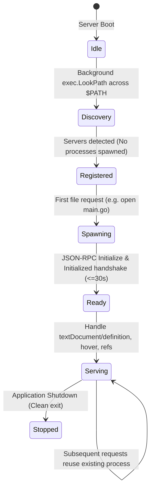
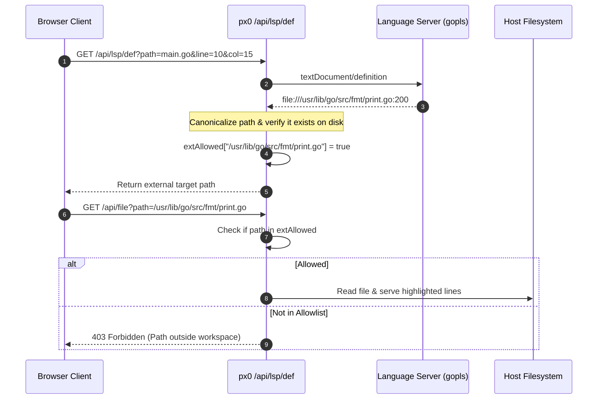

# Language Server Protocol (LSP) Architecture & Intelligence

This document details the architecture, lifecycle management, and security boundaries of px0's Language Server Protocol subsystem ([`lsp.go`](../../lsp.go) and [`server.go`](../../server.go)), and how the Monaco editor uses it ([`web/src/lsp.js`](../../web/src/lsp.js), §8).

## 1. Zero-Cost Lazy Architecture

Traditional IDEs start multiple language server processes during project initialization, consuming hundreds of megabytes of RAM before the developer opens a single file.

px0 adopts a strictly Zero-Cost Lazy Architecture:

### Key Principles

1. Zero Boot Overhead: During startup, px0 does not launch any language servers. It scans `$PATH` concurrently via `exec.LookPath` to identify which server binaries exist on the host system.
1. On-Demand Spawning: A language server process is launched only when the user opens or queries a file matching its registered file extensions.
1. Graceful Fallback: If a server is missing, crashes, or fails initialization, the system falls back to instant regex-based symbol definitions without displaying error dialogs.

## 2. Server Registry & Extension Precedence

Language server definitions reside in [`lsp.go`](../../lsp.go). Multiple language servers can be registered for a given extension, evaluated in order of precedence:

| Language          | Extensions                   | Primary Server               | Fallback Server | Discovery Search Paths     |
| ----------------- | ---------------------------- | ---------------------------- | --------------- | -------------------------- |
| Go                | `.go`                        | `gopls`                      | -               | `$PATH`, `~/go/bin`        |
| Rust              | `.rs`                        | `rust-analyzer`              | -               | `$PATH`, `~/.cargo/bin`    |
| TypeScript / JS   | `.ts`, `.tsx`, `.js`, `.jsx` | `typescript-language-server` | -               | `$PATH`, npm global prefix |
| Python            | `.py`                        | `pyright`                    | `pylsp`, `ruff` | `$PATH`, `~/.local/bin`    |
| C / C++           | `.c`, `.cpp`, `.h`, `.hpp`   | `clangd`                     | -               | `$PATH`, Homebrew LLVM     |
| Zig               | `.zig`                       | `zls`                        | -               | `$PATH`                    |
| Lua               | `.lua`                       | `lua-language-server`        | -               | `$PATH`                    |
| Ruby              | `.rb`                        | `solargraph`                 | -               | `$PATH`, Gem bin           |
| Java              | `.java`                      | `jdtls`                      | -               | `$PATH`                    |
| C#                | `.cs`                        | `omnisharp`                  | -               | `$PATH`                    |

## 3. Communication & Lifecycle Management

Each active language server is managed by an `lspClient` struct:

### Stdio JSON-RPC Transport

- Communication occurs via standard input/output (`os/exec.Cmd.StdinPipe` and `StdoutPipe`).
- Messages conform to the Language Server Protocol (Content-Length delimited JSON-RPC).
- Responses are correlated using atomic sequence IDs.

### Concurrency & Serialization

- Requests are serialized through thread-safe channels.
- Operations that exceed time budgets (e.g., hanging server queries) are bounded by contexts (`context.WithTimeout`).
- Server initialization enforces a strict 30-second timeout.
- Document synchronization (`ensureOpen`) checks `c.opened[uri]` under a read lock before reading from disk, avoiding redundant `os.ReadFile` calls on subsequent hover, definition, and reference queries.
- Location responses (`locate`) decode single-object or array `Location` / `LocationLink` payloads from `json.RawMessage` in a single RPC call, and UTF-16 column conversion (`utf16ToByte` / `fromLSPLine`) operates directly on the target line (`d.Raw(line)`) without allocating full-file line slices.

## 4. External Path Boundary Sandboxing (`extAllowed`)

When a developer navigates code using Go-to-Definition (`F12`), the target definition often resides outside the workspace directory (e.g., standard library packages in `/usr/lib/go/src` or third-party dependencies in `~/.cargo/registry`).

Allowing arbitrary filesystem reads would introduce path traversal vulnerabilities. px0 solves this with an In-Memory Target Allowlist:

- Target paths returned by the server are normalized and admitted into `extAllowed`.
- External files can be opened and inspected, but cannot be enumerated, searched, listed in the sidebar explorer tree, or saved (`/api/file/save` resolves through `safePath`, which has no external exception).

## 5. Stateless Call Hierarchy Trails ([`lsp.go`](../../lsp.go))

`/api/lsp/calls` serves incoming and outgoing call hierarchy without holding graph state in server memory. The current Monaco frontend has no call hierarchy view and does not call it.

### Opaque Item Round-Tripping

- The LSP specification identifies call hierarchy items with an implementation-specific `CallHierarchyItem` object.
- When expanding a function, the server sends this JSON object to the client.
- To expand a caller or callee, the client sends the exact `CallHierarchyItem` back to `/api/lsp/calls`.
- Zero Server State: px0 maintains no in-memory graph trees; cost scales strictly with the nodes a client expands. Detecting recursive loops is left to the client.

## 6. In-App Setup & One-Click Installers

`/api/lsp/setup` reports, for a file's language, whether a server is installed and the install recipes for the host OS; `/api/lsp/install` runs one, and `/api/lsp/start`, `/api/lsp/stop` and `/api/lsp/servers` manage running servers. The current Monaco frontend has no setup panel: it shows the server's state in the status bar, and a server installed by hand is picked up the next time a file of its language is opened.

### Security Validation (DNS-Rebinding Defense)

Executing installation commands (e.g., `go install` or `npm install`) requires robust security precautions:

1. `/api/lsp/install` accepts only `POST` requests.
1. The `Origin` header must exactly match the `Host` header.
1. The `Host` header must resolve strictly to `127.0.0.1`, `[::1]`, or `localhost`.
1. Commands are pulled strictly from the internal `lspRegistry`, and the client request cannot provide or modify the command string.

## 7. Diagnostics (`textDocument/publishDiagnostics`) & Idle Server Reaping

- **Diagnostics**: `lspClient` advertises `publishDiagnostics: {}` during `initialize` and parses incoming `textDocument/publishDiagnostics` notifications into per-file `LSPDiagnostic` slices (errors and warnings). `/api/lsp/diagnostics` (and `/api/file`) expose them; the editor turns them into Monaco markers (§8).
- **Idle Reaping (`ReapIdle`)**: Each `lspClient` records its last activity timestamp (`lastUsed`). The server's background scavenger (`Server.scavenge()`) calls `lspManager.ReapIdle(10 * time.Minute)`, shutting down idle language servers without marking them permanently stopped so they respawn transparently on the next request.

## 8. The Monaco Side (`web/src/lsp.js`)

`initLsp()` registers Monaco providers for every registered language on `file` URIs (workspace documents), backed by px0's endpoints. Positions are converted at the boundary: Monaco counts lines and columns from 1 in UTF-16 units; the API takes 1-based lines and 0-based UTF-16 columns.

| Monaco provider | Endpoint | Fallback |
| --- | --- | --- |
| Hover | `/api/lsp/hover` (`wait` 2 s) | none |
| Definition (F12, Ctrl/Cmd+Click, Peek) | `/api/lsp/def` (`wait` 5 s once the server is ready, 15 s while it starts) | `/api/def?sym=<word>`: px0's symbol index, for the word under the cursor |
| References (Shift+F12) | `/api/lsp/refs` (`wait` 8 s) | none |
| Document symbols (Go to Symbol, Outline) | `/api/lsp/symbols` | `/api/outline`: the regex outline (`internal/symbols`) |

- **Warm-up.** When a file tab becomes active, `warm(path)` calls `/api/lsp/warm`, which starts the language server for the file's language if one is installed. While the state is `starting` or `indexing` it polls again (up to 25 times, 0.9 s apart). The state (`off`, `starting`, `indexing`, `ready`, `failed`) and the server's name are kept per path and shown in the status bar.
- **Peek targets.** Monaco's peek widgets need models for the files they show, so the definition and reference providers open documents (`openDoc`) for up to 40 result files first. A definition in another file opens it through `registerEditorOpener` in `editors.js`; paths outside the workspace open read-only.
- **Diagnostics.** `refreshDiagnostics(path)` reads `/api/lsp/diagnostics` and sets the model's `lsp` markers (severity, message, source, code, range). It runs when the server becomes ready, 600 ms after each save, and every 4 seconds for open documents whose server is ready and the page visible. Markers feed the squiggles, `F8` navigation, and the Problems panel (`problems.js`), which lists every marker by file.
- **No completions.** px0 registers no completion, rename, formatting or code action providers; Monaco's own word-based suggestions are all the editor offers.
