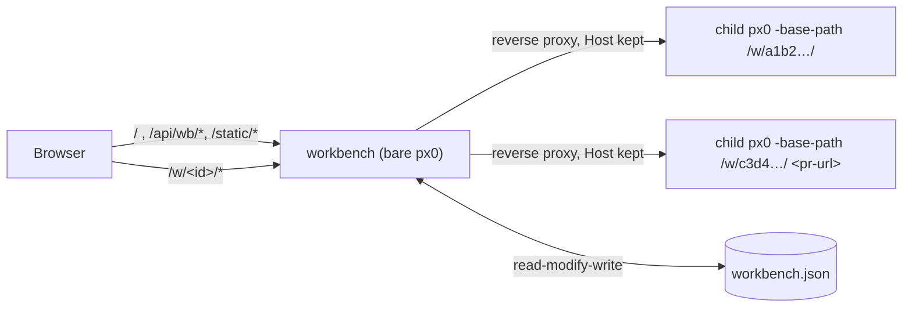

# Workbench Internals

The workbench (`workbench.go`, `web/workbench.html`, `web/src/workbench/main.js`, `web/src/css/workbench.css`) is what `px0` serves when started without a target. It is a supervisor and reverse proxy, not a multi-workspace server: every directory or pull request it opens runs as a separate child px0.

## Why child processes

`Server` is built around a single workspace: one `Index`, `lspManager`, `prSession`, `GitWatcher` and `diffBase`, all fixed in `main()`. Rather than threading a workspace ID through every handler, the workbench re-runs the px0 binary per workspace. Each child keeps px0's single-workspace performance, a crashing or memory-hungry language server only takes down its own child, and stopping a child frees everything it held.



## Children

`workbench.start` runs:

```
px0 [passed-on flags] -workbench-child -host 127.0.0.1 -port 0 -no-open -no-update -no-color -base-path <wb>/w/<id>/ <dir | pr-url>
```

- **Readiness.** With `-workbench-child`, `main` prints `px0-ready <addr>` once it is listening. The workbench reads child output through `lineWriter`, which also drops spinner frames (`\r`), and keeps the last 20 lines; `wbChild.failure` reports the last `px0: …` line as the error.
- **Lifetime.** The workbench holds the child's stdin. The child treats EOF on stdin as SIGTERM and shuts down the normal way, which removes PR worktrees and stops language servers. This works if the workbench is stopped, crashes or is killed, on every platform. `stop` closes stdin and kills the child after 5 seconds. `cmd.WaitDelay` keeps a grandchild holding the output pipes from blocking `Wait`.
- **States.** `starting` → `running` → `stopped`, or `failed` if the child exits before it is ready or takes longer than `wbStartTimeout` (3 minutes; a PR may clone a large repository). Live state is kept only in memory and never written to `workbench.json`.
- **Idle stop.** The proxy counts requests in flight per child; an open tab always holds an event stream. `reapIdle` stops children with none in flight for `wbIdleAfter` (30 minutes).
- **PR clones.** `checkoutPR` makes a worktree when its working directory is a clone of the PR's repository, so the workbench starts every PR child in one (see below). Before the child is launched, `run` resolves the clone, or makes one, while the state is `starting` and `progress` says what it is waiting on. `stop` cancels this through `wbChild.ctx`.

## PR clones ([`workbench.go`](../../workbench.go))

Every PR is a worktree of one local clone per repository; nothing is cloned per PR.

- **Matching.** `findPRRemote(dir, owner, repo)` (pr.go) returns the clone's top level and the name of the remote that points at the repository. It checks `origin` first, then `upstream` (a fork), then any other remote. `remoteMatchesRepo` compares the parsed `owner/repo` of https, ssh and scp-style URLs exactly, ignoring case. The old check, a substring test on `origin`, matched `px0` against `px0-docs`. `checkoutPR`, `computeDiffBase` and `Pull` fetch from that remote rather than assuming `origin`. An empty remote name still means `origin`.
- **Finding.** `findClone` tries `knownClone` first: the clone remembered in `workbench.json` (`clones`, keyed by lowercased `owner/repo`), then the recorded directories, then the workbench's cwd. Failing that, `scanForClone` searches the usual code folders under home and the parents of recorded directories, breadth-first, three levels deep. It skips hidden and dependency folders, looks at no more than 20,000 entries and gives up after 1.5 seconds, and it only considers folders named like the repository that hold a `.git`. A clone found this way is remembered.
- **Asking.** `/api/wb/open` checks for a clone before it records a PR. With none, it returns `{needClone, repo, managed}` and the page asks. The next request passes `clone`, either a folder (verified with `cloneOf`, then remembered) or `"managed"`.
- **px0's own clone.** `makeClone` clones once into `<state>/repos/<owner>/<repo>`, as a partial clone (`--filter=blob:none`) with no checkout of its own. It clones into a sibling temp folder and renames it into place, so an interrupted clone never looks finished. A per-repository mutex keeps two PRs opened together from cloning twice.
- **Credentials.** `gitLocalThenToken` runs the head fetch and `worktree add` with the clone's own git credentials first, and with the GitHub token only if that fails. A partial clone fetches file contents during `worktree add`, which a private repository's token covers. A user's clone may have broader access than the token, so its credentials go first.
- **Reopening.** A recent PR reopened from its holding page whose clone has disappeared fails with `errNoClone`. The holding page then offers **Choose a clone**, which links to the workbench with `?open=<url>`.
- **CLI.** `main` passes `knownClone`'s result (memory and recorded directories, no scan) to `checkoutPR` when `px0 <pr-url>` runs outside a matching clone.

## Proxy

`/w/<id>/…` goes to the child's `httputil.ReverseProxy`, which has `FlushInterval: -1` so event streams are not buffered. The proxy keeps the browser's `Host` header (`pr.Out.Host = pr.In.Host`), so the child's `localPost` check, which compares `Host` with `Origin`, still passes. The child serves under its own base path, and its `/api/meta` reports `workbench`, the workbench's base path. The editor (`web/src/api.js`'s `inWorkbench`/`wbURL`) uses it for the title bar's link back to the workbench, **File > Open Workbench**, and the Repositories view and `Alt+O` switcher (`web/src/repos.js`), which call the workbench's `/api/wb/state`, `/api/wb/repos`, `/api/wb/repostatus` and `/api/wb/open` on the same origin.

If the child is not running, a GET of the workspace page itself (`/w/<id>/`) starts it and returns a holding page. The page refreshes every second until the child is ready, or shows the error. Other paths return 503. This is why a bookmarked or reloaded workspace reopens, and why the workbench page can use plain links for known items.

## Page

`web/workbench.html` loads `static/dist/workbench.js` and `workbench.css`, built by `scripts/build-web.js` from [`web/src/workbench/main.js`](../../web/src/workbench/main.js), a second bundle entry. The page imports only `util.js`, `theme.js` and `quickinput.js` (for the theme picker) from the editor's modules, not Monaco. It is laid out like VS Code's Welcome page: **Start** (the path / PR URL box with folder completion, the clone prompt for a PR without a known clone, and **Open \<cwd\>**), **Recent**, **Browse**, and **Repositories**, with a title bar holding the theme picker and a status bar with the version, the number of running workspaces and the summed CPU and memory.

The status bar's metrics come from the workbench's `/api/metrics`, which sums its own process with each running child's `/api/metrics`, fetched directly rather than through the proxy so the polling does not count against idle stop, and returns the parts; the page shows them as the tooltip. `/api/settings` on the workbench only accepts `workbench.colorTheme`, which `theme.js`'s `setTheme` posts. `/api/wb/complete?q=` lists folders whose names start with `q`'s last path element (case-insensitive), spelled the way `q` spells its parent (`~/`, relative) so the input does not jump. Repository rows read their status lazily from `/api/wb/repostatus` as they scroll into view.

## Inside a workspace

`web/src/repos.js` gives every workbench child a way to move between repositories without going back to the page:

- `listRepositories()` merges `/api/wb/state` (recently opened, with running state, the current one marked) and `/api/wb/repos` (every repository found), de-duplicated by item ID.
- `openInWorkbench({target} | {id}, newTab)` posts `/api/wb/open` and navigates to the returned `/w/<id>/`. For a new tab it opens the tab synchronously first (so the popup blocker allows it) and points it at the result. A PR whose repository has no known clone goes to the workbench page with `?open=<url>`, which asks for one.
- The **Repositories** view (activity bar) and **Switch Repository...** (`Alt+O`, the status bar's workspace item) use these. The view fetches `/api/wb/repostatus` for visible rows, four at a time.

## Item IDs

`wbItemID` is the first 6 bytes, as hex, of the SHA-256 of the kind plus a key: the cleaned absolute path for a directory, or the lowercased `provider/owner/repo#n` for a pull request. The ID is stable, so `/w/<id>/` is stable. A PR's review drafts are saved in a session file named after the same ID (`prSessionFilePath`), so they survive a reopen, from the workbench or from `px0 <pr-url>`, even though each opening checks the PR out into a new temporary directory.

## Store

`wbStore` keeps nothing in memory. Each change re-reads `workbench.json`, applies the change, trims the list (pinned entries plus the 50 most recent) and writes it back atomically (temp file + rename). A plain `px0 <dir>` or `px0 <pr-url>` records itself through `recordRecent`, so the workbench must not overwrite entries it never loaded. An unparseable file is renamed to `workbench.json.bad` rather than overwritten.

An item added by `/api/wb/open` that fails before its child is ready is removed again (`forget`), so a mistyped URL does not stay in the list. The holding page still shows the error from the in-memory child.

## Single instance

`workbench.lock`, next to `workbench.json`, records the workbench's PID and loopback URL. A second bare `px0` pings `/api/wb/ping` there and opens the browser on the existing workbench if it answers. Only the process that wrote the lock removes it.

## Security

`/api/wb/browse` and `/api/wb/complete` list folders anywhere on disk, and `/api/wb/open` can start a workspace on any of them. Requests that change anything go through `localPost`: POST only, with a `Host` that is an IP address or localhost, and an `Origin` that matches it. GET requests for state and folder listings, and requests to start a workspace, go through `trustedGet`, which applies the same `Host` check against DNS rebinding. Children bind only to 127.0.0.1 and can be reached only through the proxy. When bound to a non-loopback address, the workbench prints a warning that anyone who can reach it can browse the machine.
